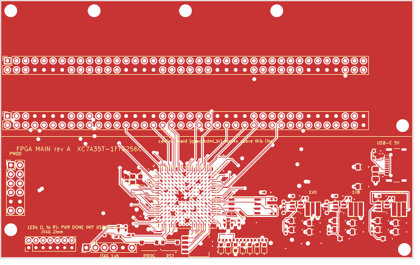
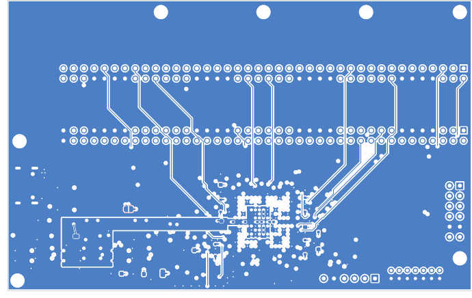
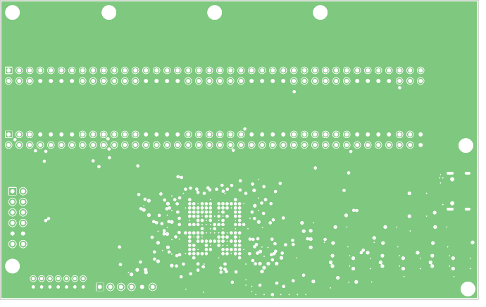
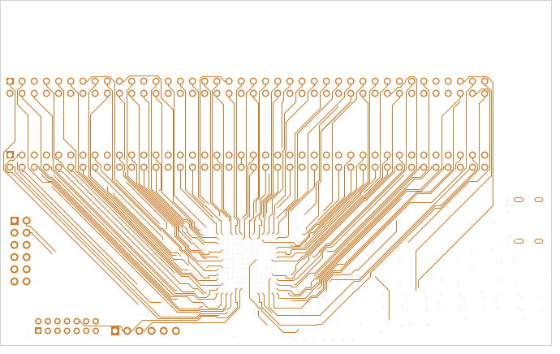
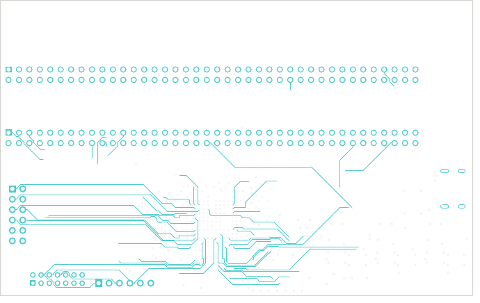
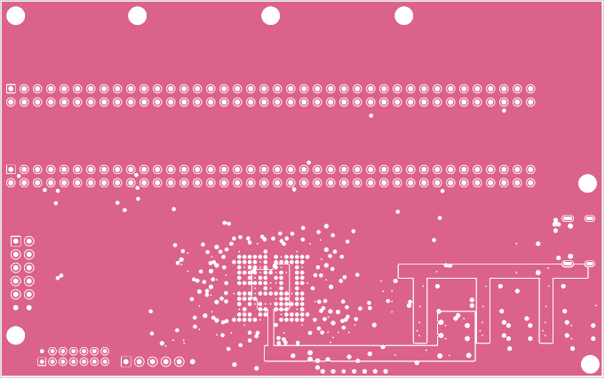
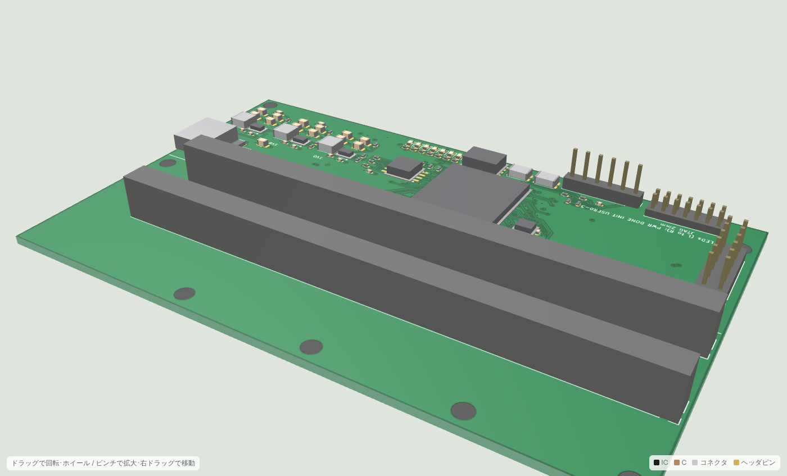
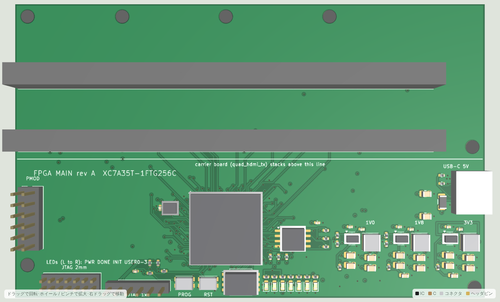
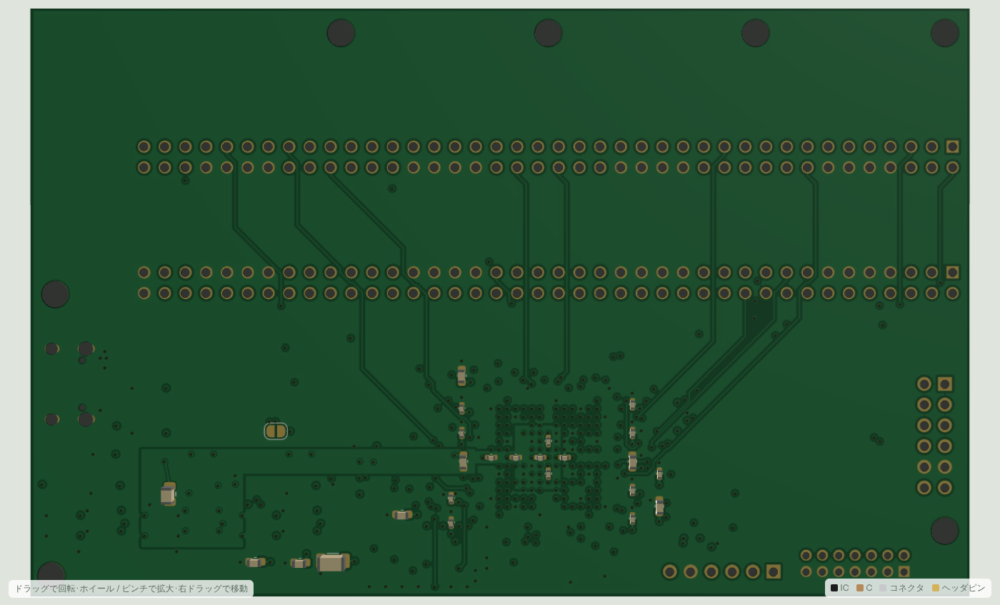

# FPGA メイン基板 (XC7A35T-1FTG256C)

キャリア基板 `quad_hdmi_tx`(rev B、ADV7513 ×4 → HDMI ×4)をソケットで上に重ねて使う、FPGA 搭載のメイン基板。
2 枚構成の下側で、電源・コンフィグ用フラッシュ・JTAG・100 MHz 発振器・ユーザ I/O を持つ。
キャリア基板の裏面ヘッダ J7/J8(2×40 SMD)に、この基板の表面ソケット J1/J2(2×40 THT)が嵌合する。

| ファイル | 内容 |
|---|---|
| fpga_main.kicad_pro / *.kicad_sch | KiCad 7 プロジェクト(ルート + 電源 + FPGA I/O + FPGA コンフィグ/電源ピン + キャリアソケット + ユーザ I/O) |
| fpga_main.pdf | 回路図 PDF(6 ページ) |
| netlist.net | kicad-cli で書き出したネットリスト |
| bom.csv, bom_grouped.csv | 部品表(リファレンス別 / 集計、MPN 付き) |
| fpga_pinmap.csv | 全 256 ボールの表: ピン名、バンク、ネット、キャリアのヘッダピン、方向、エスケープ層。`gen/gen_xdc.py` が `constraints/board.xdc` を作る元 |
| roles.json | 自動採番された R/C の役割 → リファレンス(レイアウト生成が配置に使う) |
| fpga_main.kicad_pcb | 基板レイアウト rev A(6 層、115 × 72 mm)。`gen/gen_fpga_pcb.py` が配置・プレーン・BGA ファンアウトを生成し、FreeRouting で自動配線 |
| drc.rpt / drc_pre.rpt | DRC レポート(配線後 / 配線前) |
| fab/ | ガーバー、ドリル、CPL、各層の PDF(`gen/export_fab.sh fpga_main`) |
| 3d/ | STEP(基板のみ)、簡易 3D モデル(OBJ + テクスチャ)、three.js ビューア |

## 回路構成

```
USB-C 5V ─ F1(PTC 2A) ─ +5V ─┬─ U3 AP63200 ─ +1V0 (VCCINT/VCCBRAM)   EN: 即時
                             ├─ U4 AP63200 ─ +1V8 (VCCAUX)           EN: 100k + 1uF  (約 30 ms 遅れ)
                             └─ U5 AP63203 ─ +3V3 (VCCO 全バンク, フラッシュ, 発振器, LED) EN: 100k + 2.2uF (約 60 ms 遅れ)
U1 XC7A35T-1FTG256C ─┬─ U2 W25Q32JV (QSPI x4、Master SPI、M[2:0]=001)
                     ├─ J3 JTAG 2x7 2.0 mm (Xilinx 14 ピン) / J4 JTAG 1x6 (Digilent HS2 配列) ─ 並列
                     ├─ X1 100 MHz → D4 (IO_L12P_T1_MRCC_35)
                     ├─ SW1 PROG(PROGRAM_B)、SW2 RST(RST_N)、SW3 DIP ×4、D1-D7 LED(PWR/DONE/INIT/USER0-3)、J5 PMOD(8 I/O)
                     └─ J1/J2 2x40 ソケット ─ キャリア基板 J7/J8 (124 信号 + GND 34 + FPGA_5V 2)
```

### FPGA まわり

| 要素 | 内容 | 根拠・備考 |
|---|---|---|
| XC7A35T-1FTG256C | 170 I/O(バンク 14/15/34/35、各 50/50/20/50)、VCCO は全バンク 3.3 V | FTG256 は 1.0 mm ピッチの 16×16 BGA。6 層で全ピンを引き出せる(下記エスケープ) |
| VCCINT / VCCBRAM = 1.0 V | 同じレール(-1 スピードグレードでは VCCBRAM = VCCINT = 1.0 V が可) | DS181 |
| VCCAUX / VCCADC / VCCBATT = 1.8 V | XADC は未使用: VREFP/VREFN/VP/VN/GNDADC → GND、DXP/DXN 開放 | UG480 / UG475 |
| コンフィグ | Master SPI x4。M0 = 4.7k プルアップ、M1/M2 = GND、CFGBVS = VCCO_0 = 3.3 V | UG470 |
| PROGRAM_B | 4.7k プルアップ + タクトスイッチ SW1 | |
| INIT_B | 4.7k プルアップ + 赤 LED(Low のとき点灯 = 未コンフィグ / CRC エラー) | |
| DONE | 330 Ω プルアップ + 緑 LED(1k) | UG470 の推奨 330 Ω。LED 点灯時も DONE は約 3.0 V で High |
| フラッシュ | W25Q32JVSSIQ(32 Mbit、ビットストリーム 17.5 Mbit) CS/WP/HOLD 4.7k プルアップ、CCLK は E8、D0-D3 は J13/J14/K15/K16、FCS_B は L12 | バンク 14 のコンフィグ兼用ピン |
| JTAG | TMS/TDI 4.7k プルアップ(TCK/TDO は内蔵プルアップのみ) | |
| 発振器 | ASEM1-100.000MHZ-LC-T(3.2 × 2.5 mm、3.3 V、±50 ppm)、MRCC ピン D4 へ | hdl/top.v の clk100 |
| デカップリング | +1V0: 100 µF + 4.7 µF ×2 + 0.47 µF ×4、+1V8: 47 µF + 4.7 µF + 0.47 µF ×2、+3V3: 47 µF + 4.7 µF ×4(バンクごと) + 0.47 µF ×9 | UG483 の FTG256 推奨数量以上。0.47 µF は BGA 直下の十字通路と周囲(裏面) |

### キャリア基板とのインタフェース

- J1(= キャリア J7)、J2(= キャリア J8): 2×40 メス(Sullins PPTC402LFBN-RC、高さ 8.5 mm)。ピン n はキャリアの同じ番号のピンと一致する。
- 位置はキャリアの J7/J8 のピン位置の鏡像: J1 の奇数ピン y = 16.93 / 偶数 19.47 mm、J2 の奇数 32.33 / 偶数 34.87 mm、列 k の x = 2.07 + 2.54 (k−1) mm(基板左上が原点、両基板とも同じ原点・同じ向き)。
- キャリアの SMD ヘッダの本体(2.54 mm)+ ソケット(8.5 mm)で基板間は約 11 mm。取付穴 H1-H4 はキャリアと同じ位置(26.2, 3)(51.6, 3)(77, 3)(112, 35)で、M3 × 11 mm のスペーサで固定する。
- y < 38 mm はキャリアの真下で、ソケット以外の部品は置いていない(キャリア裏面の LDO・コンデンサと干渉しない)。
- FPGA_5V(J2 の 39/40 ピン)は JP1 で +5V に繋げる。既定は開放(両基板とも自分の USB-C から給電)。両基板の JP1 を閉じると片方の USB-C で両方を動かせる(合計 2 A まで)。
- I2C のプルアップ(4.7 kΩ)はキャリア側にある。

### ユーザ I/O

| 部品 | ネット | FPGA ボール | 用途 |
|---|---|---|---|
| D4-D7(緑) | LED0-3 | R10, R11, T12, R12 | hdl/top.v の `led[3:0]`(各チャネルの初期化完了) |
| SW2 | RST_N(10k プルアップ、0.1 µF) | T3 | `rst_n` |
| SW3 DIP ×4 | SW0-3(閉で Low、内蔵プルアップを XDC で有効化) | T13, R13, T14, T15 | 予備(ビデオモード切替用) |
| J5 PMOD 2×6 | PMOD_1-4 / 7-10、GND、3.3 V | E5, E6, F5, G5, H5, J5, K5, L5(バンク 35) | 予備 I/O(Digilent Pmod 配列) |
| D1-D3 | 3.3 V / DONE / INIT_B | — | 電源 / コンフィグ完了 / 未コンフィグ |

## ピン割り当て

`gen/fpga_common.py` が決める(回路図とレイアウトの両方が同じモジュールを使うので食い違わない)。

1. **BGA エスケープ計画**: ボールのリングごとに引き出し方を固定する。リング 1(最外周)は表面パッドから直接、リング 2 は表面でリング 1 のパッドの隙間へ、
   リング 3-4 は外向き対角のセルに dog-bone ビアを打ち In2(SIG1)で整数格子線に沿って外へ、リング 5 以降の信号(JTAG、CCLK、DONE、INIT_B、PROGRAM_B、M0、PMOD)は In3(SIG2)。
   整数格子線は層ごとに 1 本の配線が占有し、各ビアは隣接 4 格子点のどれかから最寄りの辺へ向かう(占有点が重ならないよう貪欲に割り当て)。GND/電源ボールは dog-bone ビアでプレーンへ。
2. **ヘッダ信号の割り当て**: 124 本のヘッダ信号を x 順(列 k、列内は J1 奇 / J2 奇 / J2 偶 / J1 偶)に並べ、BGA の出口を周回順(左下 → 左辺 → 上辺 → 右辺 → 右下)に並べたものへ単調に対応させる。
   124 個の連続した出口の窓のうち、ヘッダピンまでの距離の総和が最小のものを選ぶ。交差が出ないので、ソケットまでの配線が素直になる。
3. 用途が決まっているボール(フラッシュ、クロック、LED、スイッチ、PMOD)は先に確保する。

結果(`fpga_pinmap.csv`): OUT1 = バンク 34/35(左辺・下辺左)、OUT2 = バンク 35(上辺左・左辺)、OUT3 = バンク 15(上辺右)、OUT4 = バンク 14/15(右辺・下辺右)。
I2C_A は H4/H2(バンク 35)、I2C_B は E15/E16(バンク 15)。未使用 I/O はリング 1-4 に 10 本、リング 5-6 に 11 本(開放)。

Vivado 用の制約は `python3 hardware/gen/gen_xdc.py > constraints/board.xdc`(hdl/top.v のポート名、`SLEW FAST`、CFGBVS/CONFIG_VOLTAGE、QSPI x4、非同期クロックグループ)。

## 基板レイアウト

### 配置(rev A: 115 × 72 mm)

```
y=0  ┌──────────────────────────────────────────────────────────────────────┐
     │  (キャリア基板の真下: H1 H2 H4 取付穴、部品なし)                       │
 17  │  J1 ████████████████████████████████████████████ (2x40 ソケット)       │
 33  │  J2 ████████████████████████████████████████████                     H3 │
 38  ├─ キャリア基板の下端 ─────────────────────────────────────────────────┤
     │ PMOD                      ┌─────────┐      U2 flash  C(3V3 47u) USB-C │
 55  │ J5   X1 100MHz  caps      │ U1 BGA  │ caps  R pull-up  U3   U4   U5   │
     │                           │ 16x16   │      1V0  1V8  3V3 bucks         │
 69  │ H5 J3 JTAG2mm  J4 JTAG1x6  PROG RST  DIP  LEDs x7           H6        │
 72  └──────────────────────────────────────────────────────────────────────┘
```

- FPGA は露出部の中央 (51.6, 55):ヘッダ中心 x と同じで、左右の信号本数が揃う。ソケット J2 の下端(y 35.7)から BGA のエスケープ終端(y 46)まで 10 mm の帯で 124 本をファンアウトする。
- J1 の信号は J2 のスルーホール列を内層で抜ける。ソケットのパッドはライブラリの 1.7 mm から 1.5 mm(穴 1.0 mm、アニュラ 0.25 mm)に縮めて列の隙間を 1.04 mm にし、隙間 1 つに 0.15 mm 配線 2 本(4 層で最大 8 本)が通る。
- フラッシュ U2 は BGA 右(バンク 14 のコンフィグピンは右辺の行 8-10 から出る)、発振器 X1 は左(D4 は In2 で左辺へ)。
- 電源は右下: USB-C は右辺、バック 3 個を横並び(1.0 V が FPGA に最も近い)。+5V は In4 の櫛形プレーン(バー + 各バックの IN 側の歯)。
- +1V0 は In4 の島(BGA 中央、VCCINT/VCCBRAM のビアを含み VCCO_0 のビアは避ける)→ 列 7.5 の通路(ビアのない中央の十字)→ 下の帯(y 65-67.6)→ U3 出力。
- +1V8 は裏面ベタ: BGA 中央右(VCCAUX ×4、VCCADC、VCCBATT)→ 行 7.5 の通路 → U4 出力への帯。
- デカップリングは裏面。0.47 µF は BGA 直下の十字通路(列 7.5 に +1V0 ×3、行 7.5 に +1V0 ×1 と +1V8 ×2、ビアはセル中心 = 半整数格子)と BGA の左右(VCCO)。バルクは下の帯と各バックの脇。

### 層構成(6 層、1.6 mm)

| 層 | 用途 |
|---|---|
| F.Cu | 部品、BGA リング 1-2 のエスケープ、配線後に GND ベタ |
| In1.Cu | GND プレーン |
| In2.Cu (SIG1) | BGA リング 3-4 のエスケープ(整数格子線)、信号 |
| In3.Cu (SIG2) | 深いリングの信号のエスケープ、信号 |
| In4.Cu (PWR) | +3V3 プレーン + +1V0 の島/腕/帯 + +5V の櫛 |
| B.Cu | デカップリング、+1V8 ベタ(BGA 中央右)、信号、配線後に GND ベタ |

### ルール

配線 0.15 mm / クリアランス 0.15 mm(BGA の 1.0 mm ピッチで、ビア 0.5 mm の隙間 0.5 mm に 0.15 mm 配線を 1 本通すため)、ビア 0.5 / 0.3 mm(アニュラ 0.1 mm)、
穴-銅 0.18 mm、銅-外形 0.3 mm。電源ネットクラス(+5V/+3V3/+1V0/+1V8/VBUS/FPGA_5V/SW ノード)は 0.4 mm 幅、ビア 0.6 mm。
dog-bone ビアは隣のボールパッド(0.4 mm)から 0.26 mm、整数格子線の配線はビアパッドから 0.175 mm 離れる。

### 生成と配線のパイプライン

```sh
cd hardware/gen
./build_fpga_main.sh                      # 回路図 → netlist.net → 基板 (配置 + BGA ファンアウト + 電源ビア) → ゾーン塗り + drc_pre.rpt
PCB_PROJECT=fpga_main python3 route_pcb.py export        # fpga_main.dsn
(cd ../fpga_main && xvfb-run -a -s "-screen 0 1280x1024x24" java -jar freerouting-1.9.0.jar -de fpga_main.dsn -do fpga_main.ses -mp 24 -oit 1.0)
PCB_PROJECT=fpga_main python3 route_pcb.py import        # SES 取り込み、未接続の島の接続、外層 GND ベタ、drc.rpt
PCB_PROJECT=fpga_main python3 layout_report.py
./export_fab.sh fpga_main                 # fab/
PY=../../../scratch/venv/bin/python ./make_3d.sh fpga_main   # 3d/: STEP、簡易 OBJ、テクスチャ、viewer.html (PY は Pillow/numpy 入りの python)
PCB_PROJECT=fpga_main ../../scratch/venv/bin/python render_images.py   # docs/images/fpga-main-*.png
python3 gen_xdc.py > ../../constraints/board.xdc
python3 check_fpga_netlist.py ../fpga_main/netlist.net && python3 check_stack.py
```

## 検証状況

- 回路図: `gen/check_fpga_netlist.py` でネットリストを検査(ヘッダ信号 124 本が J1/J2 と U1 の 2 ノード、全 256 ボールが接続または NC、電源ネットに信号ボールが混ざっていない、孤立ネットなし)。ERC は未実施(kicad-cli 7 に無い)。
- 2 枚構成: `gen/check_stack.py` でキャリアのヘッダピンとソケットピンの位置(誤差 0.000 mm)、ピンごとのネット、取付穴 H1-H4 の一致を確認。
- レイアウト: 配線前 DRC はクリアランス / 穴 / コートヤード違反 0(BGA ファンアウト 149 ビア + 112 エスケープ、電源ファンアウトビア 125)。配線後の結果は下記(未接続 0、違反 0)。
- 実機・Vivado での実装は未実施。

### レイアウトの結果

| 項目 | 値 |
|---|---|
| 配線 / ビア | 2155 本 / 405 個(スクリプトの固定配線 522 本・ビア 285 個を含む。ビアは 0.5/0.3 mm ×279、0.6/0.3 mm ×126) |
| DRC(pcbnew API) | 未接続 0、クリアランス / 穴 / 外形 / コートヤード / シルク違反 0。残り 109 件は `lib_footprint_issues`(ライブラリ名なしで読み込んだフットプリントの照合情報)のみ |
| ヘッダ信号 124 本の配線長 | OUT1 33〜83 mm(平均 56)、OUT2 14〜49(30)、OUT3 13〜46(28)、OUT4 31〜89(55)。FR4 の 90 mm は約 0.6 ns で、148.5 MHz SDR の余裕(数 ns)に収まる |
| 層別の配線長 | F 1077 mm、In2 (SIG1) 4072、In3 (SIG2) 1039、B 412 |
| 自動配線 | FreeRouting 1.9.0、40 パス、約 8 分(ルータにはビア禁止領域: BGA 直下・+1V0 の腕・裏面の +1V8 帯・外形から 0.45 mm を渡す)。INIT_B の LED 側 1 区間だけ `route_pcb.py` の MANUAL で手配線 |

| 層 | 画像 |
|---|---|
| 表面 (F.Cu) |  |
| 裏面 (B.Cu、ミラー表示) |  |
| 内層 1 (GND) |  |
| 内層 2 (SIG1: BGA リング 3-4 のエスケープ) |  |
| 内層 3 (SIG2) |  |
| 内層 4 (PWR: +3V3 / +1V0 島 / +5V 櫛) |  |

### 3D モデル

`3d/`: STEP(基板のみ)、簡易 OBJ(部品は寸法表の直方体)、three.js ビューア `3d/viewer.html`(ブラウザで開く。ドラッグで回転)。
部品の外形は近似なので、正確な 3D が要るときは KiCad の 3D ライブラリを入れて `kicad-cli pcb export step` を再実行する。

| 斜め | 表 | 裏 |
|---|---|---|
|  |  |  |

## 発注前チェックリスト

- [ ] ソケット J1/J2 の高さ(8.5 mm)とキャリア側ヘッダの嵌合長(Samtec TSM の 0.230" ピン)を実物で確認。別の高さのソケットならスペーサ長を合わせる。
- [ ] UG483 の表(FTG256 の必要コンデンサ数)と `fpga_cfg.kicad_sch` のデカップリング数量を照合(ここでは余裕を持って多めにしている)。
- [ ] AP63200 の FB 分圧(1.0 V: 10k / 40.2k、1.8 V: 24.9k / 20k)と EN の RC 遅延(データシートの EN しきい値 1.2 V 前後)を確認。
- [ ] JTAG ヘッダの配列(J3: Xilinx 14 ピン 2 mm、J4: Digilent HS2 6 ピン)を使うケーブルと照合。
- [ ] DIP スイッチ(Copal CHS-04B)、タクトスイッチ(C&K KMR2)、発振器(Abracon ASEM1)の入手性。代替品はフットプリントを合わせる。
- [ ] フラッシュ W25Q32JV: Vivado のメモリ構成ファイルは `w25q32jv-spi-x1_x2_x4`。
- [ ] 1.0 mm ピッチ BGA の 0.15 / 0.15 mm ルール、ビア 0.3 / 0.5 mm(アニュラ 0.1 mm)が製造業者の 6 層仕様に収まるか。JLCPCB の 6 層は配線/間隔 0.09 mm、ビア穴 0.2 mm(径 0.35 mm 程度)以上、PTH のアニュラ 0.13 mm なので余裕があるが、注文時の仕様ページで再確認する。
- [ ] BGA 直下の In1/In4 プレーンはビアの間の 0.2 mm 幅のメッシュになる(1.0 mm ピッチ、ビア 0.5 mm + クリアランス 0.15 mm)。通常の設計と同じだが、ガーバーで確認。
- [ ] 外層 GND ベタは BGA 直下にも入る(パッド間 0.3 mm)。不要なら `route_pcb.py` の finish 段で BGA 領域を除外する。
